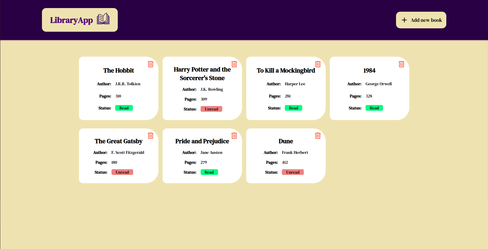

# Library App

### Description

A simple Library app that stores books as objects in an array and renders them on the page as cards. Books are built with a `Book` constructor, each with a unique ID from `crypto.randomUUID()`, and a `Book.prototype` method handles toggling read status so all instances share it. Users can add books through a `<dialog>` form, remove them, and flip their read status. Display logic is kept separate from the book data. No persistent storage; data resets on reload.

### Links

Project link: https://www.theodinproject.com/lessons/node-path-javascript-library

Live preview: https://zunaid-hassan.github.io/library-odin/

### Preview

### Attribution

**Icons**

- Book icon taken from [School and Learning pack](https://www.flaticon.com/packs/school-and-learning-7) by [Karyative](https://www.flaticon.com/authors/karyative), Flaticon

- [Material Design Icons](https://pictogrammers.com/library/mdi/) from Pictogrammers

**Fonts**

- [DM Serif Text](https://fonts.google.com/specimen/DM+Serif+Text?preview.script=Latn) by Colophon Foundry

- [Roboto](https://fonts.google.com/specimen/Roboto) by Christian Robertson, ParaType, Font Bureau

<!-- COLOR PALLETE: https://colorhunt.co/palette/2900445000718a2a78eee3b0 -->
